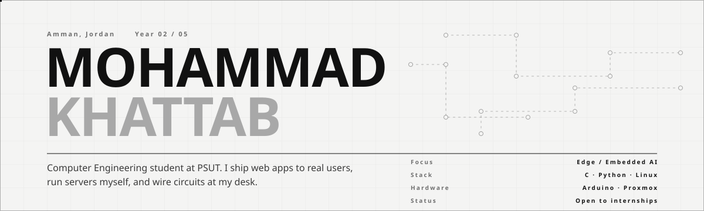
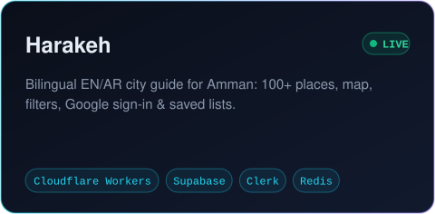
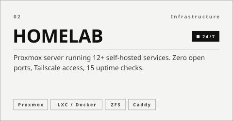
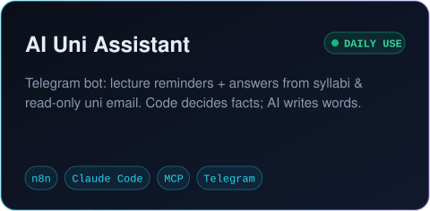
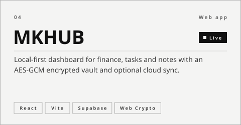

  

  
  
  

### 👋 About me

I'm a Computer Engineering student at **Princess Sumaya University for Technology (PSUT)** in Amman, Jordan. I like taking an idea all the way to something people can actually use: a live web app, a server that runs 24/7, or an automation I rely on every day.

- 🚀 Launched **[Harakeh](https://harakeh.mkll.me)**, a bilingual city guide for Amman, which I designed, built and deployed solo
- 🖥️ Run my own **Proxmox homelab** with 12+ self-hosted services, zero open ports and Telegram uptime alerts
- 🤖 Build **AI agents and automations** with Claude Code, n8n and MCP, following one rule: *code decides the facts, AI writes the words*
- 🎯 Looking for an **internship** in software, AI or infrastructure

### 🛠️ Featured work

  
  
  
  

<b>More projects</b>

 

| Project | What it is |
|---|---|
| [ClinicBot](https://github.com/Mohammad-Khattab/clinicbot) | WhatsApp bot that books clinic appointments in Arabic or English, with automatic reminders (Node.js · Twilio · Llama 3.1 · Google Sheets) |
| [MediConnect](https://github.com/Mohammad-Khattab/mediconnect-telehealth-ui) | Bilingual telehealth demo with booking, a symptom checker and a patient portal (Next.js · TypeScript) |
| [Coffee House](https://github.com/Mohammad-Khattab/coffee-house-template) | EN/AR landing page template with full RTL support (Next.js · TypeScript) |
| [Snake 3D](https://github.com/Mohammad-Khattab/snake-3d) | Neon 3D Snake with 9 maps, 20 levels and 20 skins (Three.js) |
| [MMKL Snake](https://github.com/Mohammad-Khattab/mmkl-snake) | Snake with a Node.js backend, campaign, in-game currency and skins |
| [Snakes & Ladders](https://github.com/Mohammad-Khattab/snakes-and-ladders) | Dark-fantasy board game for 2–4 players with AI opponents |
| Clap controller | Arduino microphone circuit that recognises clap patterns to control a light (C++) |

### 🧰 Tech I work with

   
   
  

### 📜 Certifications

**Anthropic:** Claude Code in Action · Claude Platform 101 · Claude Code 101 · Claude 101 · AI Fluency · Intro to Claude Cowork 
**Google:** Project Management (Foundations, Project Initiation) · Gemini Certified University Student

